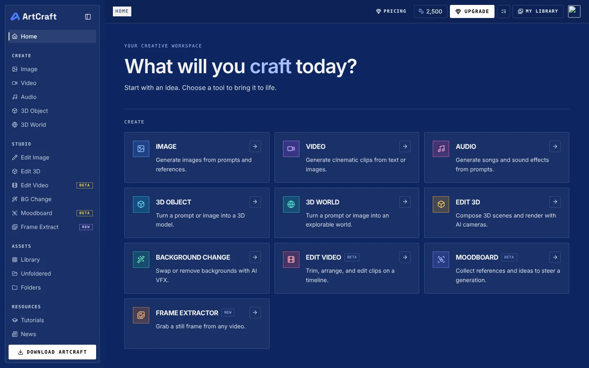
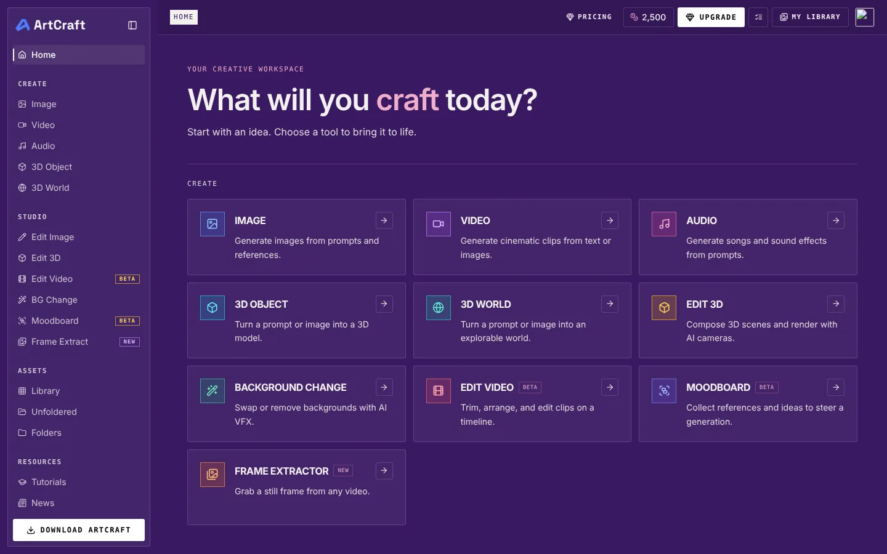
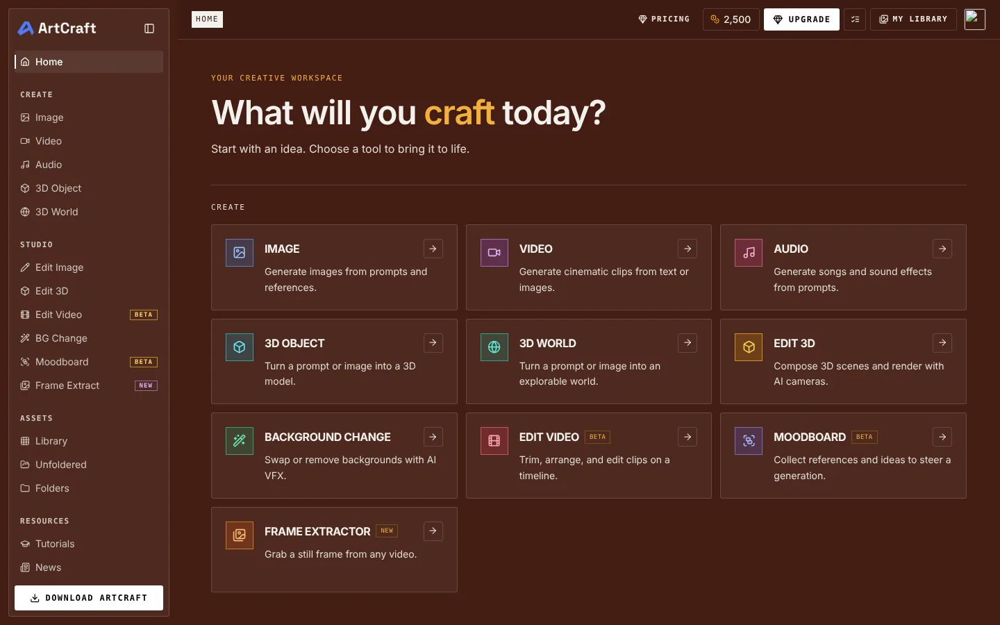
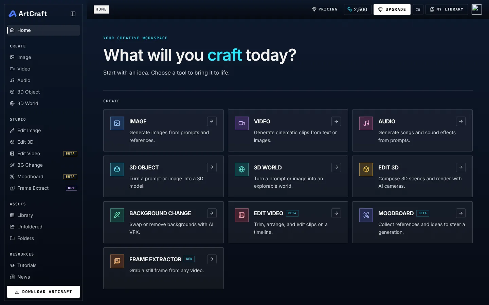
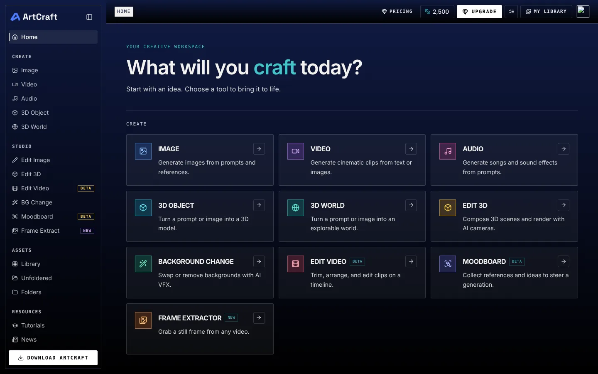
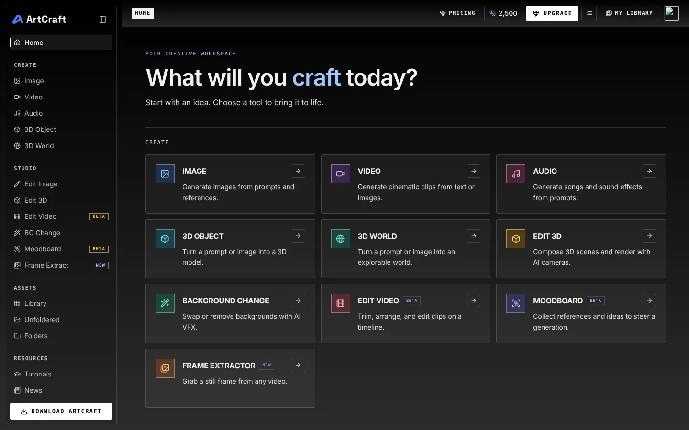
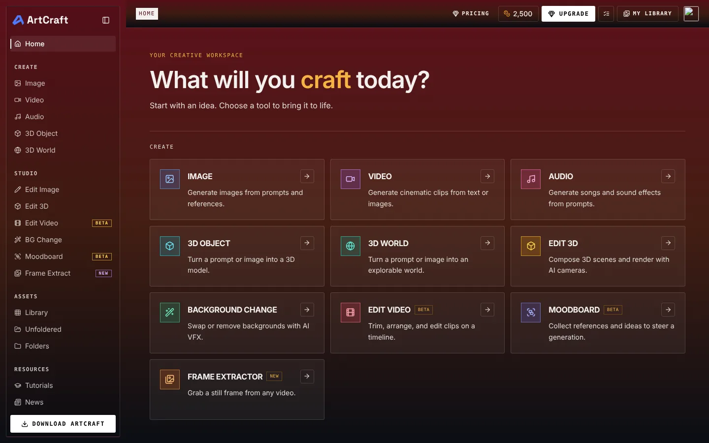

# Soul Mark Themes

Most apps give you black, white or dark blue. These themes put every color back in your hands.
Free and open for any app.

We are in the age of AI now. This puts the choice of how your software looks back in your hands: a mark, a feel, a vibe...all your own. Soul. Soul Mark Themes gives everyday users and creators alike the freedom to
personalize the software they use, and gives developers a drop-in way to offer it. Every theme
keeps text readable, so you can be as bold as you like without losing anything.

## See them

Eight signature looks from each theme, shown on the home page of
[ArtCraft](https://github.com/storytold/artcraft-services), the app Soul Mark was first made for.
Every text in every picture meets WCAG AA; the readability guard checks it, and the tests prove it.

### Soul Mark: Solid Tones

<table>
  <tr>
    <td width="50%"><br><b>Midnight and Teal</b><br>Midnight blue with a teal accent. The starter everyone sees first.</td>
    <td width="50%"><br><b>Deep blue and Light blue</b><br>Deep blue with a light blue accent.</td>
  </tr>
  <tr>
    <td width="50%"><br><b>Paper and Cobalt</b><br>White with a cobalt accent, for light mode.</td>
    <td width="50%"><br><b>Black and Blue</b><br>True black with a blue accent, for dark mode.</td>
  </tr>
  <tr>
    <td width="50%"><br><b>Deep red and Red</b><br>A deep red background with a bright red accent.</td>
    <td width="50%"><br><b>Deep purple and Pink</b><br>Deep purple with a pink accent.</td>
  </tr>
  <tr>
    <td width="50%"><br><b>Reddish brown and Amber</b><br>A deep reddish brown with an amber accent.</td>
    <td width="50%"><br><b>Deep green and Green</b><br>Deep green with a green accent.</td>
  </tr>
</table>

### Soul Mark: Gradients

The gradient flows behind the page, the side menu and every panel. Text is checked at every
point of the gradient, not just at its colors.

<table>
  <tr>
    <td width="50%"><br><b>Neon Deep</b><br>Dark blue fading to near-black, with a neon cyan accent. The starter.</td>
    <td width="50%"><br><b>Midnight and Teal</b><br>Midnight blue fading to black, with a teal accent.</td>
  </tr>
  <tr>
    <td width="50%"><br><b>White to silver</b><br>White fading to soft silver, with a cobalt accent. The light one.</td>
    <td width="50%"><br><b>Black to charcoal</b><br>Black fading to charcoal, with a blue accent. The dark one.</td>
  </tr>
  <tr>
    <td width="50%"><br><b>Aurora &nbsp;<sub>3 COLORS</sub></b><br>Deep blue, deep green, then night.</td>
    <td width="50%"><br><b>Synthwave &nbsp;<sub>3 COLORS</sub></b><br>Deep purple, deep rose, then night.</td>
  </tr>
  <tr>
    <td width="50%"><br><b>Ember &nbsp;<sub>3 COLORS</sub></b><br>Deep red, reddish brown, then night, with an amber accent.</td>
    <td width="50%"><br><b>Deep violet to black</b><br>Deep violet fading to black, with a pink accent.</td>
  </tr>
</table>

All 15 signature themes and 16 signature gradients are listed in
[`soul-mark/v2/data/signatures.json`](soul-mark/v2/data/signatures.json).

## The themes

Soul Mark: Solid Tones (v1) is the theme contributed to
[ArtCraft](https://github.com/storytold/artcraft-services).

| Theme                      | What it is                                                                | Status                   |
|----------------------------|---------------------------------------------------------------------------|--------------------------|
| Soul Mark: Solid Tones, v1 | Solid colors with a readability guard, exactly as contributed to ArtCraft | After ArtCraft merges it |
| Soul Mark: Solid Tones, v2 | The same theme, agent-ready: files, CLI, CI and MCP                       | Agent-ready              |
| Soul Mark: Gradients       | Two or three colors flowing into each other, still readable               | Agent-ready; in preview  |
| Soul Mark: Neon            | Heads-up display: glowing lines on near-black                             | Next                     |
| Soul Mark: Glass           | Frosted, see-through backgrounds, windows and menus, with clear text      | Planned                  |
| Soul Mark: High Contrast   | Strong, clear colors for anyone who wants them                            | Planned                  |
| Soul Mark: Patterns        | Textures and patterns behind the interface                                | Planned                  |

See [`docs/ROADMAP.md`](docs/ROADMAP.md) for the order and what each one includes.

## Agent-ready

Everything here follows [Cornerstone](https://github.com/Luminous-Enigma/Cornerstone): each theme
ships as plain theme files with a schema, a command line tool, automatic CI checks, an MCP server
so AI assistants can make and check themes, and a skill that teaches them how. A person, a script
and an AI can all use it, and agent tests prove an AI uses it correctly and safely.

To use it yourself, in [`soul-mark/v2`](soul-mark/v2):

```bash
npm ci && npm run build
```

```bash
node dist/cli.js check "Aurora"
```

AI assistants connect to the MCP server with `node dist/mcp.js` (stdio); `SKILL.md` there teaches
them to use it well. Details: [`soul-mark/v2/README.md`](soul-mark/v2/README.md).

Every pull request runs Cornerstone's safety gates and their self-test
([what they check](https://github.com/Luminous-Enigma/Cornerstone/blob/main/docs/GATES.md)):

```bash
bash scripts/test-gates.sh
```

```bash
bash scripts/public-gates.sh
```

Security problems: please report them privately, as [SECURITY.md](SECURITY.md) explains.

## License

[MIT](LICENSE): use it in any app, change it, share it. Keep the copyright line.

The copy of Soul Mark v1 that lives in ArtCraft is under ArtCraft's own license there; this
repository is where Soul Mark is published openly.
